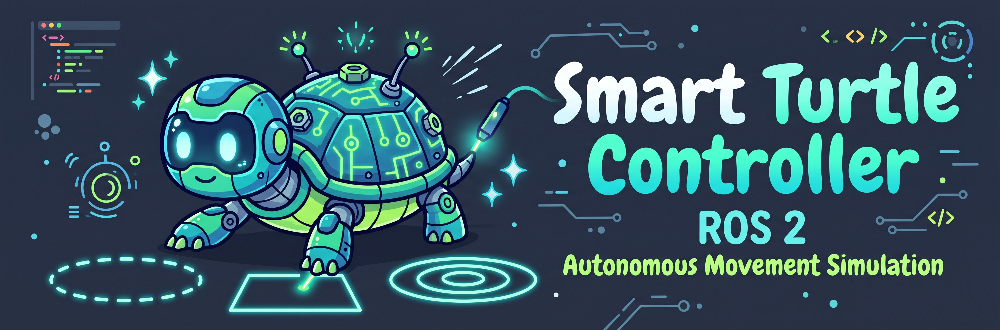

# 🐢 Smart Turtle Controller

  

  <b>A Modular ROS 2-Based Robot Control System Using Turtlesim</b>

  
  
  
  
  
  

---

## 📌 Overview

**Smart Turtle Controller** is a modular robotics project built using **ROS 2 Jazzy** and **Python**, designed to demonstrate practical robot control and communication through the Turtlesim simulation environment.

Instead of relying on hardcoded movement commands, the system uses a distributed architecture consisting of multiple ROS 2 nodes and packages that communicate through custom messages and ROS 2 communication mechanisms.

The system allows users to control a simulated turtle and generate different geometric motion patterns, including:

- **Circle:** Continuous circular movement.
- **Square:** Four-sided geometric movement.
- **Spiral:** Expanding spiral trajectory.

Users can configure movement parameters through YAML configuration files or interact with the system dynamically using a graphical interface built with Tkinter.

The project demonstrates how to design, organize, and integrate multiple ROS 2 components into a unified robotic control system.

---

## 🎯 Project Objectives

The main objectives of this project are:

- Understand ROS 2 workspace and package organization.
- Implement communication between independent ROS 2 nodes.
- Create and use custom ROS 2 message interfaces.
- Apply parameter-based configuration using YAML.
- Develop motion-control logic for geometric trajectories.
- Build a graphical user interface for real-time interaction.
- Automate system startup using ROS 2 Launch.
- Monitor and debug ROS 2 communication using RQT tools.

---

## ✨ Key Features

| Feature | Description |
|---|---|
| Custom Messages | Dedicated communication interface for turtle commands. |
| Shape-Based Control | Supports Circle, Square, and Spiral trajectories. |
| Dynamic Speed Control | Adjusts movement speed through the GUI. |
| Command Publisher | Publishes configured movement commands periodically. |
| Automated Reset | Clears the simulation and resets the turtle periodically. |
| Interactive GUI | Tkinter-based graphical control interface. |
| YAML Configuration | Configure default shape and speed without modifying source code. |
| Launch Integration | Start the complete system using a unified launch file. |
| ROS 2 Monitoring | Inspect communication and node relationships using RQT. |

---

## 🏗️ System Architecture

The project follows a modular architecture divided into three ROS 2 packages.

  

