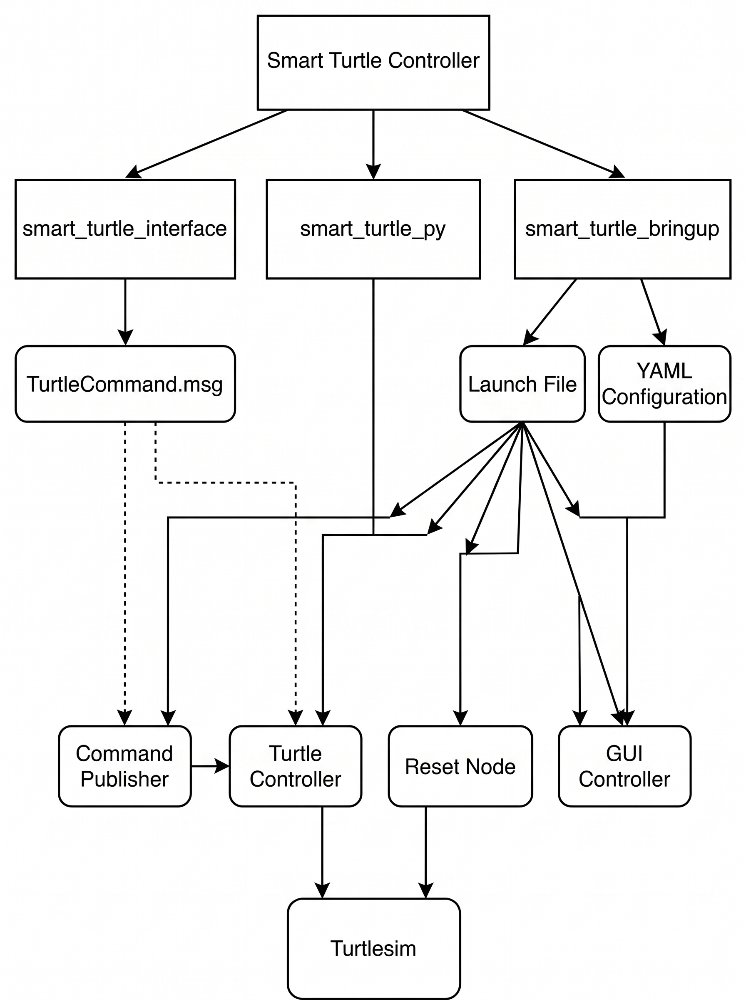
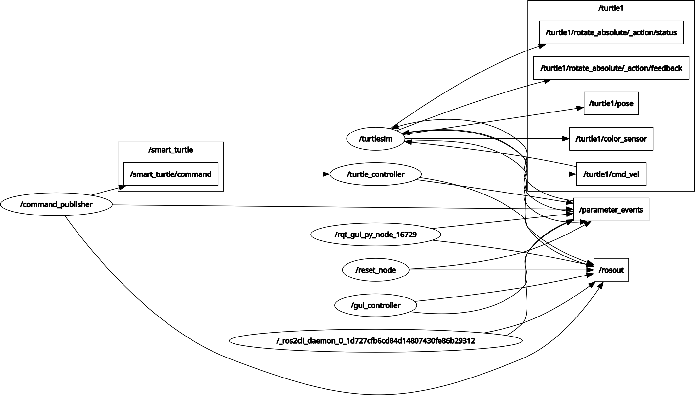
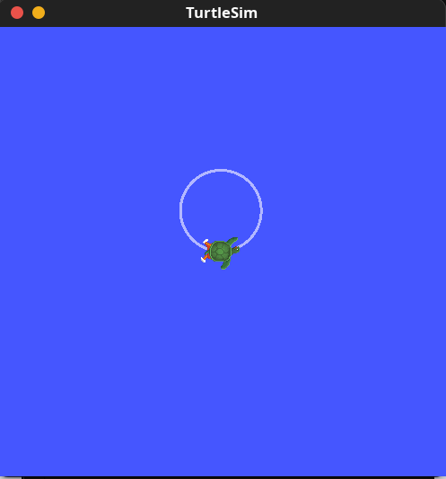
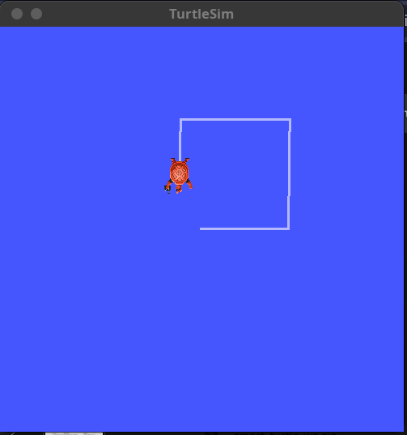
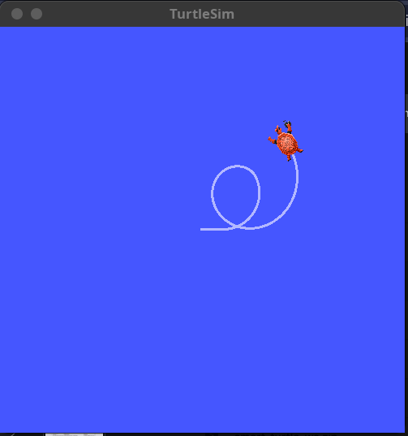
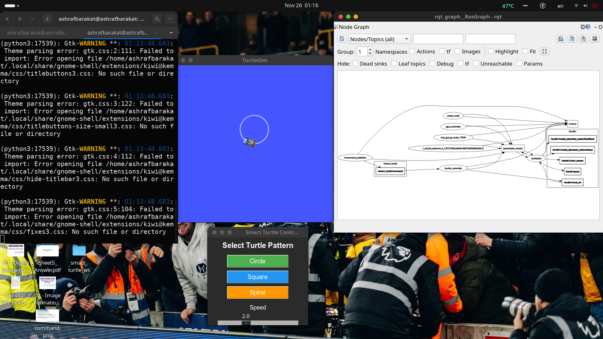

# 🐢 Smart Turtle Controller
<p align="center">
  
</p>

<p align="center">
  <b>A Modular ROS 2-Based Robot Control System Using Turtlesim</b>
</p>

<p align="center">
  
  
  
  
  
  
</p>

---


## 📌 Overview

**Smart Turtle Controller** is a modular and interactive robotics control system developed using ROS 2 Jazzy and Python. It demonstrates how to design and integrate multiple ROS 2 nodes and packages to control a simulated robot through a structured communication architecture.

The project uses the Turtlesim simulation environment, allowing users to control a virtual turtle and generate different geometric trajectories without manually writing movement commands.

The system supports three movement patterns:

- **Circle:** Continuous circular movement.
- **Square:** Sequential movement along four sides.
- **Spiral:** Expanding spiral trajectory.

Users can dynamically change the movement pattern and turtle speed through a graphical interface or command-based control.

The system also includes an automatic reset mechanism that periodically clears the simulation and returns the turtle to its initial position.

---

## 🎯 Project Objectives

The main objectives of this project are:

- Understand ROS 2 workspace and package organization.
- Implement communication between independent ROS 2 nodes.
- Design and integrate custom ROS 2 message interfaces.
- Apply parameter-based configuration using YAML files.
- Develop motion-control algorithms for geometric trajectories.
- Implement dynamic movement and speed control.
- Build a graphical user interface using Tkinter.
- Automate multi-node execution using ROS 2 Launch.
- Monitor and debug communication using RQT tools.

---

## ✨ Key Features

| Feature | Description |
|---|---|
| Custom Messages | Dedicated communication interface for turtle commands. |
| Shape-Based Control | Supports Circle, Square, and Spiral trajectories. |
| Dynamic Speed Control | Adjusts movement speed from 0.5 to 5.0. |
| Command Publisher | Publishes movement commands periodically at 1 Hz. |
| Motion Controller | Calculates linear and angular velocities at 10 Hz. |
| Automatic Reset | Clears the simulation every 10 seconds. |
| Interactive GUI | Tkinter-based graphical control panel. |
| YAML Configuration | Configures default shape and speed. |
| Unified Launch | Starts the complete system through one launch command. |
| ROS 2 Monitoring | Supports communication visualization using RQT. |

---

## 🏗️ System Architecture

The project follows a modular ROS 2 architecture divided into three independent packages.

<p align="center">
  
</p>


<p align="center">
  
</p>


## Execution Sequence

1. The bringup package loads the system configuration.
2. The launch file starts the Turtlesim simulator and the required ROS 2 nodes.
3. The command publisher reads the default movement parameters.
4. The GUI allows the user to select a shape and adjust its speed.
5. The command publisher sends the requested movement command.
6. The turtle controller processes the command and calculates the required velocities.
7. Turtlesim executes the requested trajectory.
8. The reset node periodically clears the simulation and resets the turtle.

---

## 📊 Technical Specifications

| Parameter | Value |
|---|---|
| ROS 2 Distribution | Jazzy |
| Operating System | Ubuntu 24.04 LTS |
| Programming Language | Python |
| Interface Definition | ROS 2 Custom Message |
| GUI Framework | Tkinter |
| Simulation Environment | Turtlesim |
| Command Publishing Rate | 1 Hz |
| Controller Update Rate | 10 Hz |
| Automatic Reset Interval | 10 seconds |
| Minimum Speed | 0.5 |
| Maximum Speed | 5.0 |
| Build System | Colcon |

---

## 🖥️ Simulation & GUI Demonstration

The project provides two main graphical windows during execution.

### 1. Turtlesim Simulation

The simulation window displays the turtle's movement and the trajectory drawn on the screen.

Supported movement patterns:

**Circle**

![Circle Simulation]
<p align="center">
  
</p>

**Square**

![Square Simulation]
<p align="center">
  
</p>

**Spiral**

![Spiral Simulation]
<p align="center">
  
</p>

### 2. Smart Turtle Control Panel

The graphical interface provides an interactive way to control the simulation.

Main controls:

- Green button: Circle.
- Blue button: Square.
- Orange button: Spiral.
- Speed slider: Adjusts movement speed between 0.5 and 5.0.



---

## 🛠️ Technology Stack

| Technology | Purpose |
|---|---|
| ROS 2 Jazzy | Robotics middleware and node communication |
| Ubuntu 24.04 | Development environment |
| Python 3 | Control logic and GUI implementation |
| CMake | Custom message package build configuration |
| Tkinter | Graphical user interface |
| Turtlesim | Robot simulation |
| Custom ROS 2 Messages | Structured command exchange |
| YAML | Configuration management |
| Colcon | Workspace build system |
| RQT | ROS 2 monitoring and debugging |

---

## ⚙️ Installation & Requirements

### Prerequisites

Make sure the following components are installed:

- Ubuntu 24.04 LTS.
- ROS 2 Jazzy.
- Python 3.
- Colcon.
- Turtlesim.
- Tkinter.

### 1. Install Dependencies

```bash
sudo apt update

sudo apt install ros-jazzy-turtlesim \
                 python3-tk \
                 python3-colcon-common-extensions \
                 ros-jazzy-rqt \
                 ros-jazzy-rqt-graph
```

### 2. Create the ROS 2 Workspace

```bash
mkdir -p ~/smart_turtle_ws/src

cd ~/smart_turtle_ws/src
```

### 3. Clone the Repository

```bash
git clone <YOUR_REPOSITORY_URL>
```

Make sure the three ROS 2 packages are located inside the workspace `src` directory.

### 4. Install Package Dependencies

```bash
cd ~/smart_turtle_ws

source /opt/ros/jazzy/setup.bash

rosdep update

rosdep install --from-paths src --ignore-src -r -y
```

---

## 🔨 Build Instructions

Build the workspace using Colcon:

```bash
cd ~/smart_turtle_ws

source /opt/ros/jazzy/setup.bash

colcon build --symlink-install
```

After a successful build, source the workspace:

```bash
source install/setup.bash
```

---

## 🚀 Running the Project

After building the workspace, source both ROS 2 and the local workspace:

```bash
source /opt/ros/jazzy/setup.bash

source ~/smart_turtle_ws/install/setup.bash
```

Launch the complete system:

```bash
ros2 launch smart_turtle_bringup smart_turtle.launch.py
```

The launch file starts the simulation and the required control components, including the graphical interface.

The user can then select the desired movement pattern and adjust the speed through the GUI.

---

## ⚙️ Configuration

The project uses YAML configuration files to define default movement parameters.

The configuration is managed inside:

```text
smart_turtle_bringup/config/turtle_params.yaml
```

The configured parameters allow users to customize the default movement behavior without modifying the Python source code.

---

## 📈 Monitoring & Debugging with RQT

ROS 2 provides several tools for monitoring and debugging communication between nodes.

### View the ROS 2 Graph

```bash
rqt_graph
```

Visualizes the relationships between ROS 2 nodes and topics.


### List Active Nodes

```bash
ros2 node list
```

### List Available Topics

```bash
ros2 topic list
```

### Inspect Topic Information

```bash
ros2 topic info <topic_name>
```

### Monitor Topic Messages

```bash
ros2 topic echo <topic_name>
```

### List Available Services

```bash
ros2 service list
```

These tools help visualize communication, inspect active components, and troubleshoot the system.

---

## 📚 ROS 2 Concepts Demonstrated

This project provides practical implementation of the following ROS 2 concepts:

| Concept | Application |
|---|---|
| ROS 2 Packages | Modular software organization |
| Nodes | Independent control components |
| Topics | Inter-node communication |
| Custom Messages | Structured turtle command interface |
| Parameters | Configurable movement settings |
| Services | Simulation reset and clearing |
| Launch Files | Multi-node system startup |
| YAML | Configuration management |
| RQT | Communication visualization and debugging |

---

## 🔮 Future Improvements

Potential future developments include:

- Adding more geometric movement patterns.
- Improving trajectory accuracy.
- Supporting multiple simulated turtles.
- Adding more advanced GUI controls.
- Implementing configurable reset intervals.
- Adding live movement statistics.
- Extending the controller architecture to physical robotic platforms.

---

## 👨‍💻 Author

**Ashraf Ahmed Barakat**

Mechatronics Engineering Student


## 📄 License

This project is licensed under the MIT License.

See the [LICENSE](LICENSE) file for details.

---

<p align="center">
  <b>Smart Turtle Controller</b><br>
  Exploring Modular Robotics Development with ROS 2.
</p>
